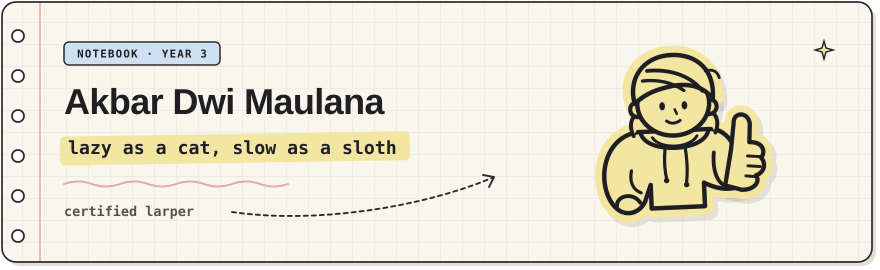
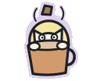
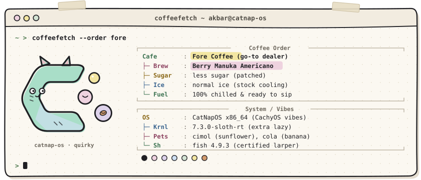

  <picture>
    <source media="(prefers-color-scheme: dark)" srcset="assets/hero-dark.svg">
    <source media="(prefers-color-scheme: light)" srcset="assets/hero-light.svg">
    
  </picture>

  <strong>3rd-Year CS Student</strong> ·
  <em>lazy as a cat, slow as a sloth</em>
  

  
  
  

> *Slow mornings and shipping things at my own pace.*

## Notes

Hey, I'm Akbar, a 3rd-year CS student who likes taking things steady with a warm cup nearby, turning small ideas into calm, practical software across systems, web, and mobile.

- **Currently working on:** [opspilot](https://github.com/kuenobaikbanget/opspilot), a self-hosted Linux monitoring and evidence-first AI incident investigation tool, alongside exploring Linux observability and AI agent workflows.
- **Also built:** [finnote](https://github.com/kuenobaikbanget/finnote) (*"The Quiet Pocket Ledger"*), an unhurried Android expense tracker for students, plus small IoT tinkering.
- **Offline:** hanging out with ginger, tuxedo, and meme cats, hunting down good coffee spots, and keeping things unhurried.

## Toolbox

**Systems &amp; Backend**

  
  
  
  
  
  

**Web &amp; Mobile**

  
  
  
  
  
  
  
  

 

## Pinned Pages

  
  

## Coffee Order

  <picture>
    <source media="(prefers-color-scheme: dark)" srcset="assets/coffee-terminal-dark.svg">
    <source media="(prefers-color-scheme: light)" srcset="assets/coffee-terminal-light.svg">
    
  </picture>

  
  

